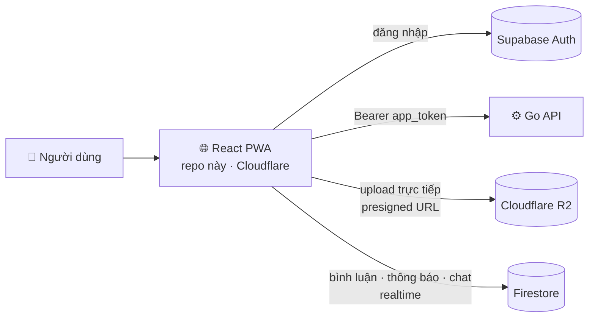

<div align="center">


# Checkpoint — Web (React PWA)

**Ứng dụng web chính của Checkpoint, mạng xã hội du lịch cho Việt Nam: check-in, cắm cờ lên bản đồ và sưu tầm con dấu trên hộ chiếu du lịch số.**
Bản đang chạy thật tại **[checkpoint-app.space](https://checkpoint-app.space)** — cài được như app trên điện thoại.


<br/>
[](https://checkpoint-app.space)
[](https://github.com/handao2303/checkpoint-app)

</div>

---

## 🎬 Demo

<div align="center">
<a href="https://checkpoint-app.space"></a>
</div>

---

## 🧭 Vai trò trong hệ thống



Web là bản đầy đủ nhất và là chuẩn để hai bản mobile (React Native, Flutter) bám theo.

---

## ✨ Tính năng

| Màn hình | Người dùng làm được |
|---|---|
| **Bản đồ** | Xem check-in theo vùng đang nhìn, gom cụm marker (supercluster), lọc theo danh mục, check-in bằng GPS |
| **Tạo check-in** | Chụp bằng camera trong app hoặc chọn ảnh/video, đọc EXIF, nén ảnh, chuyển HEIC, upload thẳng lên R2 |
| **Khám phá · Feed** | “Đang hot gần bạn”, địa điểm theo khoảng cách, feed mọi người và feed người đang theo dõi |
| **Chi tiết** | Ảnh/video phóng to, thả cảm xúc, bình luận realtime, chia sẻ qua link `/c/:id` · `/p/:id` · `/j/:id` · `/u/:username` |
| **Hồ sơ** | Hành trình, XP và level, cắt avatar + khung avatar theo cấp độ, sửa hồ sơ |
| **Gamification** | Huy hiệu, hộ chiếu số theo tỉnh thành, bảng xếp hạng |
| **Chat · Thông báo** | Nhắn tin và thông báo trong app |

**Trải nghiệm:** song ngữ Việt / Anh (i18next), tài khoản Khách nâng cấp được, re-auth 2 tầng + single-flight khi token hết hạn, định vị bền cho iOS PWA, tải MapLibre lười để trang đầu nhẹ.

---

## 🚀 Chạy local

```bash
cp .env.example .env     # điền URL Go API, Supabase, Firebase
npm install
npm run dev              # http://localhost:5173
npm run typecheck        # tsc --noEmit
npm run build            # → dist/
```

## 🚢 Deploy

```bash
npm run deploy           # build + wrangler deploy (Cloudflare Workers static assets, SPA fallback)
```

GitHub Actions `deploy.yml`: **Typecheck** → **Deploy to Cloudflare Workers**, báo từng bước qua Telegram.

---

## 📂 Cấu trúc

```
src/
├── main.tsx · App.tsx      router (trang nặng tải lười)
├── index.css               Tailwind v4 + design tokens
├── pages/                  Map · Create · Discover · Feed · Chat · Profile · Leaderboard · Badges · Login · Legal · LinkRoutes
├── components/             46 component: sheet kéo được, camera, crop avatar, khung avatar, lightbox…
├── auth/ · context/        AuthContext, phiên Khách
├── lib/                    api (re-auth) · supabase · firebase · share · geo · exif · image · video · i18n · locales
├── location/ · hooks/      định vị và hook dùng chung
└── icons/                  bộ icon SVG tự host
```

<div align="center">
<sub>Một phần của <a href="https://github.com/handao2303/checkpoint-app">Checkpoint</a> · <a href="https://checkpoint-app.space">checkpoint-app.space</a></sub>
</div>
